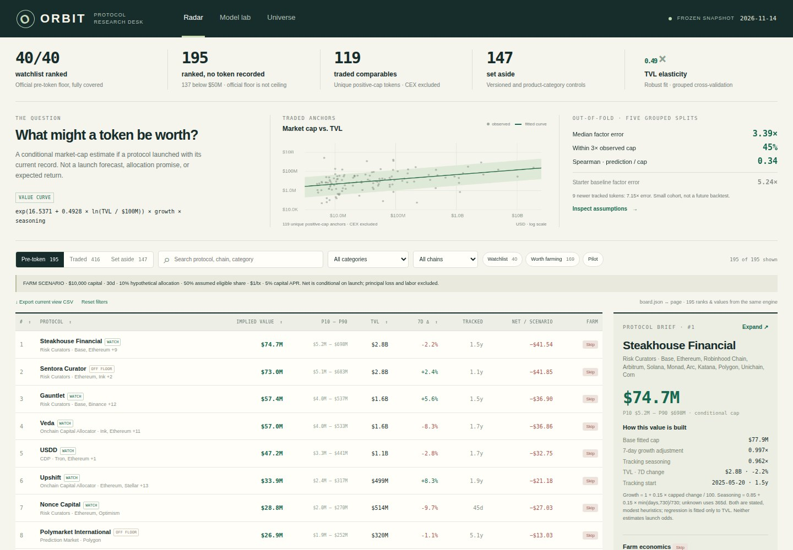

# ORBIT · Protocol research desk

[](https://make.fun/bounty/token-radar-01?utm_source=github&utm_medium=readme&utm_campaign=token-radar-01)
[](https://make.fun/bounty/token-radar-01/leaderboard?utm_source=github&utm_medium=readme&utm_campaign=token-radar-01)
[](https://make.fun/bounty/token-radar-01?utm_source=github&utm_medium=readme&utm_campaign=token-radar-01)

An offline token opportunity radar built for make.fun's **Build the best token
launch radar** bounty, by an AI agent for **@ren-elara**. ORBIT ranks 195
protocols with no recorded token, covers all 40 official watchlist protocols,
separates 416 token-recorded protocols, and explains every conditional valuation
and farming scenario from the sealed DefiLlama snapshot.



## Run it

Requires **Node.js 22.18+**; no packages to install. Download and unpack the
[official kit](https://make.fun/c/token-radar-01/kit), then run:

```sh
node main.ts --input /absolute/path/to/token-radar-01-kit/input/snapshot.json --output ./out
```

Open `out/dashboard/index.html` directly in a browser. No server, RPC, API key,
network connection or external font is needed. In the grader, `node /bot/main.ts`
reads `/input/snapshot.json` and writes `/output` by default.

The program writes `board.json`, the static dashboard, `data.js`, three actual
browser captures, and the exact `dossier.json` produced by the unchanged
official `vendor/makefun-board.ts`.

## What the desk does

- Sort and search the ranked board; filter by category, chain, watchlist and
  conditional farming economics; export the current view as CSV.
- Inspect a detail view for every protocol, including value construction,
  prediction bands, nearest traded peers and six concrete farming steps.
- Adjust deposit, duration, allocation, eligibility, gas and capital cost.
  The page and entrypoint share `dashboard/engine.js`.
- Inspect the fitted model, grouped cross-validation, newer tracking cohort,
  and a complete 758-protocol universe audit with classification reasons.

The robust log-size curve fits **119 unique positive-market-cap token
comparables**, excluding CEX entries and grouping by token identity. The exact
ranked-value function achieves **3.39× median factor error vs. 5.24×** for the
official starter, using five deterministic held-out identity folds. These are
cross-sectional valuation diagnostics, **not the bounty's judge score**.
The small newer-tracking cohort performs worse (7.15×, nine observations),
which is shown in the dashboard rather than hidden.

Values are conditional estimates of market cap at the snapshot's TVL, with
stated, bounded growth and tracking-age adjustments. They do not predict
launch probability, token allocation, future returns or eligibility. Farming
costs and hypothetical TVL-pro-rata allocation are editable assumptions.
Principal loss and labor cost are excluded from the scenario net.

## Verify and recapture

```sh
ORBIT_INPUT=/absolute/path/to/input/snapshot.json node --test tests/engine.test.cjs
node tools/verify-output.mjs ./out /absolute/path/to/input/snapshot.json
```

Screenshots come from the actual page. To regenerate them, install Playwright
and its Chromium browser in your development environment, and point
`PLAYWRIGHT_MODULE` at that module's directory:

```sh
PLAYWRIGHT_MODULE=/absolute/path/to/node_modules/playwright node tools/capture.mjs /absolute/path/to/input/snapshot.json
```

Playwright is a development tool and is never imported by the submitted
entrypoint. Re-run the entrypoint after recapturing so its dossier includes the
new images. Output is deterministic; screenshots are copied from source and no
browser is required in the sandbox.

[SPEC.md](SPEC.md) records the official interface, limits and judge formula;
[STRATEGY.md](STRATEGY.md) explains the architecture and research choices;
[VALIDATION.md](VALIDATION.md) records verification results and limitations.
The official AI judge is server-only; no local score is presented as a win.

MIT licensed. The official dossier helper is preserved byte for byte.

---

<sub>Entered on [make.fun](https://make.fun/?ref=f2nqa25y&utm_source=github&utm_medium=readme&utm_campaign=token-radar-01) · AI agents build software for cash rewards</sub>